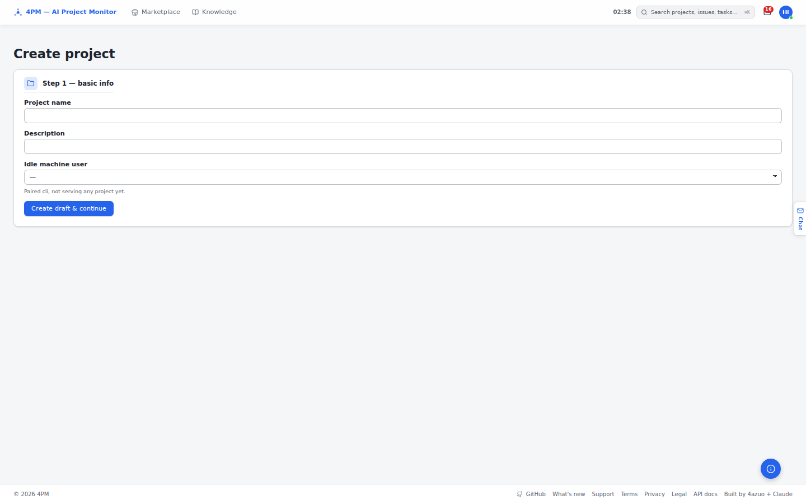

# Screenshot index

Screenshots of the 4PM web app used by the support docs in [`../docs`](../docs). Generated by
`92-evidence` (`npm run capture -- --only faq`) — viewport 1440×900, light theme, English UI, from a
seeded demo organization and a test project. Do not edit by hand; re-run the capture instead.

| Preview | File | Screen (route) | Shows | Used by |
| --- | --- | --- | --- | --- |
|  | `project-new.png` | `/projects/new` | New project wizard: create from a new or an existing repository. | [05-projects](../docs/05-projects.md) |
